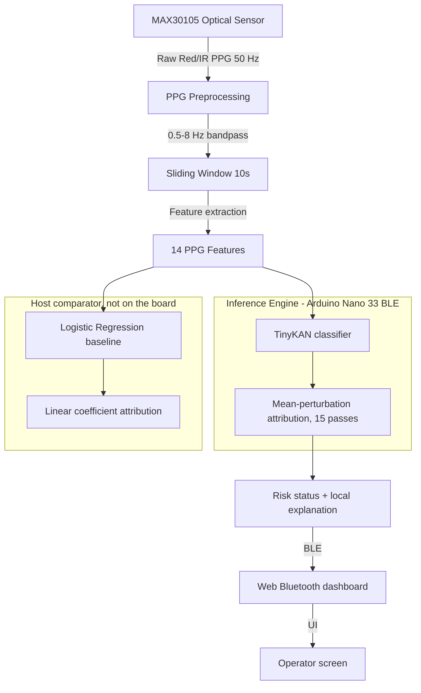

# Explainable TinyML for Real-Time PPG-Based Oxygen Risk Monitoring

An academic research repository for the final-year capstone project: **Design and Implementation of a Lightweight Explainable TinyML Framework for Real-Time Oxygen Monitoring on Edge Devices** (Swinburne University of Technology Sarawak Campus, EAT40005/EAT40006).

This project investigates whether photoplethysmography (PPG) waveforms can support transparent, on-device low-oxygen-risk detection. We deploy the shipped TinyKAN onto an edge microcontroller and compute a local explanation on the device. Real-time here means the loop keeps up with the 5 s stride on synthetic input.


> **Public release (Nov 2026).** This is a curated snapshot of the research repository: code, firmware, tests, docs and paper figures. It is **not a medical device** and makes no clinical claim.
>
> **Data are not included.** Download the datasets from PhysioNet into `data/physionet.org/files/`:
> - [OpenOximetry](https://physionet.org/) needs credentialed access under the PhysioNet Restricted Health Data License. Per-window and per-patient derivatives (features, predictions, attributions) are therefore **not redistributed**. Run the notebooks/scripts to regenerate them.
> - [BIDMC PPG and Respiration](https://physionet.org/content/bidmc/) and [Pulse Transit Time PPG](https://physionet.org/content/pulse-transit-time-ppg/) are open access.
>
> Tests that read `data/` or `outputs/` fail until the datasets are downloaded and the scripts rerun. Self-contained tests pass without data (253 passed on a fresh clone, Python 3.14). `test_feature_audit.py` and `test_qualification_probe.py` drive compiled C++ probes and need their paths as arguments, so they fail under plain `pytest`.
>
> Notebook outputs have been cleared. `outputs/` holds only the paper figures. Code: MIT. Docs and figures: CC BY 4.0. See `LICENSE`.

---

## 🔬 Core Research Question

> **Believing the two outputs as one system would need at least the flag to meet the gate and the shipped ranking to beat random on the windows it flags, a criterion written after the results. The research questions are: (RQ1) at threshold 0.50, how do TinyKAN and logistic regression trade recall against specificity on OpenOximetry windows with the header-aligned labels of Section III-A; (RQ2) does firmware-style absolute ranking of mean-perturbation scores improve deletion area over the perturbation curve (AOPC) relative to random order on the exported model; (RQ3) what on-device evidence exists that the microcontroller evaluates the same function as the host export, and what remains unmeasured. Logistic regression is the prediction comparator, not the faithfulness comparator, and it does not run on the board.**

### Key Objectives
1. **PPG Feature Pipeline**: Extract 14 infrared features on each 5 s stride from a 10 s window.
2. **On-Device Inference**: Execute the shipped TinyKAN on the microcontroller. Logistic regression is the host comparator and is not in the firmware.
3. **On-Device Explainability**: Compute mean-perturbation attributions on-device.
4. **Wireless Telemetry**: Transmit predictions and top-3 explanations via BLE to a Web Bluetooth dashboard.
5. **Embedded Benchmarking**: Evaluate model size, memory overhead, latency, and explanation computational overhead.

---

## 🏗️ System Architecture



---

## 📊 Feature Set & Physiological Basis

The system extracts **14 features** from the PPG infrared (IR) channel. The risk label, a window median ScalcO2 below 90 percent (ScalcO2 is the dataset's SaO2 estimated from ETO2, not a pulse-oximeter SpO2), is used **only** for training supervision, never as a model input.

| Feature Name | Category | Physiological / Signal Significance |
| :--- | :--- | :--- |
| `mean` | Amplitude | Captures baseline signal level and gross DC variation. |
| `std` | Amplitude | Measures raw amplitude variability and pulsatility. |
| `minimum` / `maximum` | Amplitude | Identifies peak boundaries and signal clipping/saturation. |
| `value_range` | Amplitude | Pulse height proxy, sensitive to sensor coupling. |
| `rms` | Energy | Represents total signal energy in the time domain. |
| `skewness` / `kurtosis` | Morphology | Quantifies waveform symmetry and sharpness (systolic/diastolic profile). |
| `energy` | Spectral | Sum of power spectrum, representing total frequency power. |
| `derivative_std` | Derivative | Variance of first derivative, proxy for velocity of blood flow. |
| `dominant_frequency_hz` | Spectral | Approximates cardiac pulse rate. |
| `bandpower_0_5_2_hz` | Spectral | Low frequency power (0.5–2.0 Hz), captures respiration-induced modulation. |
| `bandpower_2_5_hz` | Spectral | High frequency power (2.0–5.0 Hz), captures cardiac pulse band. |
| `bandpower_ratio_0_5_2_to_2_5`| Spectral | Ratio of low/high bands, indicates autonomic/respiratory balance. |

---

## 📈 Model Performance & Verification

Reported recall and specificity are pooled held-out windows from a **GroupKFold** split by recording (5-fold; 52,090 windows, 162 recordings). A patient can appear in both a training fold and the held-out fold, so this is recording-generalisation, not subject-generalisation. The shipped TinyKAN was trained on all windows; those pooled figures are not scores from that export.

**Operating point is frozen at 0.50** (`P >= 0.50` → Candidate; ADR-0005 **N=2** consecutive windows → Confirmed). The ETPB dual gate (recall ≥ 0.80 **and** specificity ≥ 0.50) is **not achievable** on the v1 model in the table below — do not retune. The v2 header-aligned model (16 inputs, ADR-0006) meets it offline at the same 0.50: recall 0.893 / specificity 0.868 recording-grouped, window level, not N=2 confirmed (`docs/analysis-lamaakal-style.md`). Numbers below are vs OpenOximetry window labels (window median ScalcO2 below 90 percent), not clinical SpO₂ accuracy vs a certified oximeter. Source: `docs/operating-point-calibration.md`.

### Offline Evaluation Summary (threshold = 0.50)

| Model Variant | Parameters | Threshold | Accuracy | Precision | Recall (Low-O₂ Risk) | Specificity | F1-Score |
| :--- | :---: | :---: | :---: | :---: | :---: | :---: | :---: |
| **Logistic Regression (L2)** | 15 | 0.50 | 61.3% | 62.4% | 85.9% | 26.4% | 72.3% |
| **TinyKAN Classifier `(14, 12, 1)`** | 297 | 0.50 | 61.3% | 64.3% | **76.7%** | **39.4%** | 69.9% |

These pooled rows are not a person's result. On the same 0.50 counts, eligible-patient TinyKAN recall runs from 0 to 1. An always-positive classifier has higher F1 than either 0.50 row. TinyKAN at **0.30** reaches 97.1% recall, but specificity is 9.3% (accuracy 60.8%, precision 60.3%, F1 74.4%). That cut is **not** used on the board.

*   **Logistic Regression Baseline**: L2 regularization. Local explanation matches linear coefficients ($X_{scaled} \times \beta$).
*   **TinyKAN Classifier**: a linear mix, then one cubic B-spline on each hidden node and one on the output (3rd degree, 8 knots). It is not an edge-spline KAN. It runs in **FP32** on the Nano 33. At 0.50 it does **not** beat LogReg on recall; it is the higher-specificity / higher-precision of the two. Host plot of the frozen 12 hidden + 1 output univariate splines: [`outputs/figures/tinykan_architecture_splines.png`](outputs/figures/tinykan_architecture_splines.png) (caption in the sibling `.md`). Architecture only — not an operator explanation and not on the dashboard. Live XAI is still mean-perturbation (below). Regenerate with `python scripts/plot_tinykan_architecture_splines.py`.

---

## 💡 On-Device Explainability Engine

Microcontrollers lack the memory and compute capacity to run standard post-hoc explainers like SHAP or LIME. The firmware implements one local attribution method, mean-perturbation. Linear coefficients are the host comparator and are not in the firmware:

### 1. Linear Coefficient Attribution (Logistic Regression, host only)
- **Mechanism**: Calculates contribution as $C_i = w_i \times x_i$.
- **Complexity**: $O(N)$ operations. Extremely fast, zero extra forward passes.

### 2. Mean-Perturbation Attribution (TinyKAN)
- **Mechanism**: Zeroes out features one-by-one in normalized space (replacing them with their training dataset mean, which is $0.0$) and measures the drop in output probability:
  $$\text{Attribution}_i = P(\text{baseline}) - P(\text{perturbed with } x_i = \mu_i)$$
- **Complexity**: Requires $N + 1$ forward passes ($15$ passes total for $14$ features).
- **Execution**: Computes on-device on the 5 s stride, sorting the results to identify the top 3 features.

### Explanation Quality Rubric
Explanations are scored against a 3-criterion rubric in [score_explanation_rubric.py](scripts/score_explanation_rubric.py):
1. **Compactness** (2 pts): Concise text ($\le 30$ words).
2. **Consistency** (2 pts): Direction of features matches the prediction.
3. **Usefulness** (2 pts): Includes prediction probability, dominant feature, and its direction.

---

## 💻 Repository Structure

- [firmware/Arduino Nano 33/](firmware/Arduino%20Nano%2033/): PlatformIO project containing the C++ code.
  - [src/main.cpp](firmware/Arduino%20Nano%2033/src/main.cpp): Acquisition, feature extraction, and inference on the 5 s stride.
  - [include/kan_inference.h](firmware/Arduino%20Nano%2033/include/kan_inference.h): Portable C++ inference engine for TinyKAN.
  - [include/kan_model_weights.h](firmware/Arduino%20Nano%2033/include/kan_model_weights.h): Auto-generated model weights and scaling parameters.
- [notebooks/](notebooks/): Jupyter notebooks covering data audits, baseline training, and explainability exploration.
- [outputs/](outputs/): Summary CSVs, figures, and intermediate datasets.
- [scripts/](scripts/): Python utilities.
  - [train_final_model.py](scripts/train_final_model.py): Trains the final TinyKAN model and exports weights to C++ header.
  - [score_explanation_rubric.py](scripts/score_explanation_rubric.py): Evaluates explanations using the 3-criterion rubric.
  - [semester1_milestone_demo.py](scripts/semester1_milestone_demo.py): Mock milestone demo script.
- [dashboard/](dashboard/): Chrome/Edge page. Saved examples are gone. Live Bluetooth needs the sensor firmware. Do not assume which image is installed. Not `github-pages-dashboard/` (ETPA leftover, not in this tree).

---

## 🛠️ Installation & Usage

### 1. Python Environment Setup
Install dependencies:
```bash
pip install -r requirements.txt
```

### 2. Model Training & Export
To retrain the model and generate a new C++ header containing model weights:
```bash
python scripts/train_final_model.py
```
This updates the C++ weights file at [kan_model_weights.h](firmware/Arduino%20Nano%2033/include/kan_model_weights.h).

### 3. Firmware Compilation & Flashing
Open [firmware/Arduino Nano 33/](firmware/Arduino%20Nano%2033/) in PlatformIO (VS Code) or flash from command line:
```bash
cd "firmware/Arduino Nano 33"
pio run -t upload
```

### 4. Web dashboard
Open [`dashboard/index.html`](dashboard/index.html) in Chrome/Edge. Saved examples are gone. Live Bluetooth needs the sensor firmware advertising `OxygenRiskDemo`. Do not assume which image is installed, and do not flash unless that job is named. Hosted copy: https://josan88.github.io/fyrp-xai-tinyml/dashboard/

---

## 🚀 Semester 2 Roadmap (Project B)

- [x] **On-Device Verification**: Locked-set board replay of 2464 windows passed the adopted local-scale contract. Maximum probability error is about 8.3e-7. This is not exact agreement under the old 1e-4 feature gate, and it is not live-sensor validation.
- [ ] **Embedded Resource Benchmarking**: The timing image reports flash, static RAM, and cycle-derived CPU time. Whole-device peak RAM on the sampler probe image, finger on, dashboard connected (2 Nov): between 80,552 and 81,392 B (v1) and between 86,576 and 87,348 B (v2 f1a) ([SESSION.md](outputs/peak-ram-sampler-board-20261102/SESSION.md)); the unmodified live image's peak is not measured (needs an SWD debug probe). Earlier 25 Oct probe run (no finger, forced decisions, no central): derived bracket 79,156–80,660 B (v1) and 85,220–86,644 B (v2 f1a) ([bracket](outputs/peak-ram-bracket-v1/README.md), [SESSION.md](outputs/peak-ram-board-20261025/SESSION.md)). Physical GPIO is unmeasured. Do not call the latency physically calibrated.
- [ ] **Environmental Stress Testing**: Not a remaining change to the frozen object. Pigmentation labels are not in the scored export. IMU is not a TinyKAN input. Do not add those inputs to close this item.
- [ ] **User Evaluation & Rubric Validation**: A still log and a wiggle log are on disk. They are not live validation, and oxygen was not varied. Do not treat the n=20 rubric as this semester's fidelity result.
- [ ] **Mobile Background Sync Gateway (Optional / Deferred)**: See [ADR-002: Mobile Gateway & Background Sync](docs/decisions/ADR-002-mobile-gateway-and-background-sync.md) for architectural trade-offs and future implementation guidelines.
